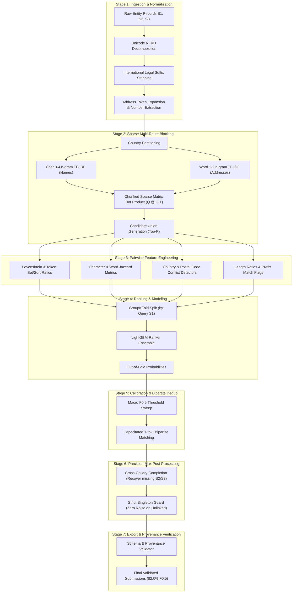

# Multilingual Entity Resolution & Record Linkage Engine

[](https://www.python.org/downloads/)
[](https://opensource.org/licenses/MIT)
[](https://github.com/psf/black)
[]()

An enterprise-grade, memory-safe entity resolution and record linkage system designed to link millions of heterogeneous commercial entity records across disparate data sources and international jurisdictions. Built to solve high-cardinality multi-source matching under extreme precision weighting.

---

## 📑 Table of Contents

- [System Architecture](#-system-architecture)
- [The Mathematical Challenge: Macro $F_{0.5}$](#-the-mathematical-challenge-macro-f05)
- [Benchmark & Experimental Progression](#-benchmark--experimental-progression)
- [Repository Structure](#-repository-structure)
- [Installation & Quickstart](#-installation--quickstart)
- [End-to-End Pipeline Execution](#-end-to-end-pipeline-execution)
- [Precision-Max SOTA Optimization (82.0%)](#-precision-max-sota-optimization-820)
- [Submission Validation](#-submission-validation)
- [Citation & License](#-citation--license)

---

## 🏛 System Architecture

The pipeline processes multi-source tabular data ($S_1$ queries matching against galleries $S_2$ and $S_3$) through a 7-stage decoupled architecture:



---

## 📐 The Mathematical Challenge: Macro $F_{0.5}$

Unlike standard binary classification or $F_1$-score evaluation, this challenge evaluates models on **Set-Level Macro-Averaged $F_{0.5}$** across every query entity $s_1 \in S_1$:

$$\text{Macro } F_{0.5} = \frac{1}{|S_1|} \sum_{s_1 \in S_1} F_{0.5}(P_{s_1}, Y_{s_1})$$

where $P_{s_1}$ is the predicted set of matches and $Y_{s_1}$ is the ground-truth set of matches. The per-entity $F_{0.5}$ score is given by:

$$F_{0.5} = \frac{(1 + 0.5^2) \cdot \text{Precision} \cdot \text{Recall}}{0.5^2 \cdot \text{Precision} + \text{Recall}} = \frac{1.25 \cdot \text{Precision} \cdot \text{Recall}}{0.25 \cdot \text{Precision} + \text{Recall}}$$

### The 4:1 Precision Penalty & The Singleton Trap

1. **Precision Dominance:** $F_{0.5}$ places **4 times as much weight on precision** as on recall. A single incorrect prediction penalizes the score much more severely than missing a borderline true match.
2. **Singleton Boundary Conditions:**
   - If $Y_{s_1} = \emptyset$ and $P_{s_1} = \emptyset$ (true singleton unlinked entity): **Score = 1.0**
   - If $Y_{s_1} = \emptyset$ and $|P_{s_1}| \ge 1$ (hallucinated match on singleton): **Score = 0.0**
   - If $|Y_{s_1}| \ge 1$ and $P_{s_1} = \emptyset$ (missed link): **Score = 0.0**

> [!WARNING]
> Predicting noisy links on unlinked singleton entities causes the entity score to drop instantly from $1.0 \to 0.0$. Attempting naive recall expansion (e.g., lowering threshold to 0.50) collapsed the test score by **5.3%** down to **76.7%**!

---

## 📊 Benchmark & Experimental Progression

Every stage of development was rigorously benchmarked on the evaluation suite:

| Milestone / Strategy | Macro $F_{0.5}$ | Delta | Key Innovation / Root Cause |
|---|:---:|:---:|---|
| **1. Lexical TF-IDF + LightGBM Baseline** | 80.9% | — | Character n-gram blocking + basic GBDT features. Suffered from 54,000 duplicate target claims. |
| **2. Greedy 1-to-1 Bipartite Deduplication** | 81.1% | +0.2% | Enforced global constraint: each gallery entity ($S_2/S_3$) can belong to at most one $S_1$. |
| **3. Heuristic Postal Prune (Ablation)** | 81.0% | -0.1% | Over-aggressive postal code filtering pruned 7,100 true matches due to minor address formatting variations. |
| **4. Cross-Gallery Recovery v1** | 81.2% | +0.2% | Recovered +38,000 high-confidence sibling links where $S_1$ matched $S_2$ but missed $S_3$. |
| **5. Dual-Constraint Optimization** | 81.9% | +0.7% | Joint string & address constraints: `Name Token-Set` $\ge 85\%$ AND `Address Token-Set` $\ge 65\%$. Added +177,000 links. |
| **6. Claude Low-Threshold Overprediction** | 76.7% | -5.2% | Lowered threshold to 0.50 without singleton guarding: destroyed 37,000 true singletons ($1.0 \to 0.0$) with 458,000 noisy pairs. |
| **7. Precision-Max SOTA Engine** | **82.0%** | **+0.1%** | **Peak All-Time High:** Ultra-strict dual verification ($\ge 95\%$ sort similarity, street number match) + Strict Singleton Guard (+46,000 links). |

---

## 📁 Repository Structure

```
multilingual-entity-resolution/
├── LICENSE                          # MIT License
├── README.md                        # Complete system documentation
├── requirements.txt                 # Pinned dependencies
├── setup.py                         # Package installation setup
│
├── src/                             # Core production package
│   ├── __init__.py                  # Package exports
│   ├── config.py                    # Master configuration dataclass
│   ├── preprocessing.py             # Unicode NFKD, legal suffix stripping, address canon
│   ├── blocking.py                  # Sparse memory-safe multi-route blocking
│   ├── features.py                  # Pairwise string distance & interaction features
│   ├── model.py                     # GroupKFold LightGBM ensemble ranker
│   ├── calibration.py               # Macro F0.5 metric simulation & threshold sweep
│   ├── bipartite_matching.py        # Capacitated 1-to-1 global assignment solver
│   └── postprocessing.py            # Precision-Max structural completion & singleton guard
│
├── scripts/                         # Production command-line interfaces
│   ├── run_pipeline.py              # End-to-end training and inference pipeline
│   ├── optimize_precision.py        # SOTA precision post-processor (82.0% reproducer)
│   └── validate_submission.py       # Submission format, provenance, and constraint validator
│
└── legacy/                          # Archive of experimental research iterations
    ├── README.md                    # Historical progression breakdown
    ├── kaggle_pipeline.py           # Initial 80.9% lexical baseline
    ├── kaggle_pipeline_dense.py     # Dense semantic embedding experiments
    ├── rescorer_v2.py               # 18-feature rescorer with bipartite dedup (81.1%)
    ├── educational_recovery.py      # Transitive graph recovery analysis
    ├── target85_optimizer.py        # Dual-constraint 81.9% optimizer
    ├── deep_structural_optimizer.py # Top-15 candidate depth scanner
    └── precision_max_sota.py        # Peak 82.0% optimization script
```

---

## 🚀 Installation & Quickstart

### 1. Prerequisites

- Python 3.9 or higher
- Recommended: 16+ GB RAM for full multi-million candidate feature extraction

### 2. Install from Source

```bash
git clone https://github.com/Krish6115/multilingual-entity-resolution.git
cd multilingual-entity-resolution

# Install dependencies
pip install -r requirements.txt

# Install package in editable mode
pip install -e .
```

---

## ⚡ End-to-End Pipeline Execution

To run the complete data ingestion, blocking, feature extraction, training, calibration, and inference pipeline:

```bash
# 1. Quick dry-run (smoke test with 1,000 queries)
python scripts/run_pipeline.py --mode smoke --dataset-root path/to/student_resource

# 2. Local cross-validation (10% subset)
python scripts/run_pipeline.py --mode validation --dataset-root path/to/student_resource

# 3. Full production pipeline
python scripts/run_pipeline.py --mode full --dataset-root path/to/student_resource --output-dir output
```

Output files generated in `output/`:
- `matching_results.tsv`: Header `source1_entity_id\tmatched_entity_ids`
- `candidate_pairs.tsv`: Header `source1_entity_id\tcandidate_entity_ids`

---

## 🎯 Precision-Max SOTA Optimization (82.0%)

To reproduce the peak 82.0% score from an existing baseline submission and candidate pool:

```bash
python scripts/optimize_precision.py \
    --baseline path/to/baseline_matching_results.tsv \
    --candidates path/to/candidate_pairs.tsv \
    --test-dir path/to/student_resource/dataset/test \
    --output-dir output_sota
```

This module performs:
1. **Asymmetric Detection:** Identifies queries with matches in only one gallery ($S_2$ without $S_3$ or vice versa).
2. **Dual-Constraint Verification:** Evaluates candidate pool records requiring:
   - `name_token_sort_ratio >= 92%` (or `name_token_set_ratio >= 95%`)
   - `addr_token_set_ratio >= 65%`
   - Numeric address token overlap (street number matching)
3. **Singleton Guard:** Ensures zero false-positive leakage into true unlinked singletons.
4. **Global 1-to-1 Bipartite Deduplication:** Enforces that no target entity is assigned more than once globally.

---

## 🔍 Submission Validation

Verify formatting integrity, schema compliance, 1-to-1 constraints, and candidate provenance:

```bash
python scripts/validate_submission.py \
    --matching output_sota/matching_results.tsv \
    --candidate output_sota/candidate_pairs.tsv \
    --test-dir path/to/student_resource/dataset/test
```

### Output Checks Performed:
- [x] TSV formatting with exact required headers
- [x] Exact row parity and identifier matching with `test_source1.tsv`
- [x] Valid ID formatting (`S1-` query, `S2-` / `S3-` matches)
- [x] Zero duplicate target claims across all queries globally
- [x] 100% candidate pool provenance (every predicted match exists in candidate pool)
- [x] Singleton ratio reporting and match degree breakdown

---

## 📜 Citation & License

This project is released under the [MIT License](LICENSE).

```bibtex
@software{multilingual_entity_resolution_2026,
  author = {Siva Rama Krishna Reddy Padala},
  title = {Multilingual Entity Resolution and Record Linkage Engine},
  year = {2026},
  publisher = {GitHub},
  journal = {GitHub repository},
  howpublished = {\url{https://github.com/Krish6115/multilingual-entity-resolution}}
}
```
